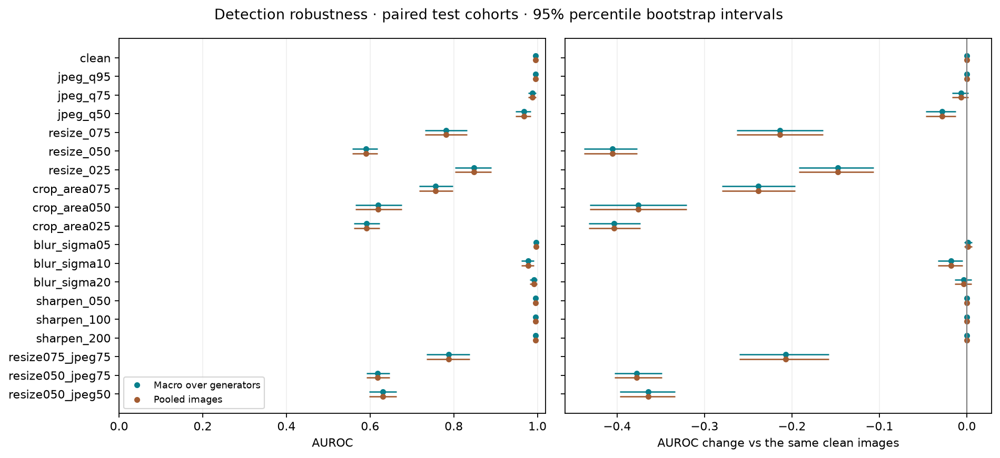

# Robustness results

FSD detected clean images well in this cohort, but ordinary geometric processing
substantially weakened detection. Half-size resizing reduced macro AUROC from
**0.9953 to 0.5898**, and cropping to 25% area reduced it to **0.5916**. JPEG and
blur also exposed a distinction between ranking quality and decisions at a fixed
threshold. These failures persisted in the matched original-code comparison;
they cannot be attributed to the AN extractor on the cases checked.

The study completed on 8 November 2026 with **5,800 cases and zero errors**, using
the RTX 2060 and `an/.venv`. It evaluates official upstream main commit
`50f2eae06efdac2e5a33f407ca9a27a2295133ac` with explicit v1.2.0 release weights.
The [full report](results/main/report.md) contains all conditions, source-level
results, uncertainty intervals, residual galleries, and runtime plots.

## Experimental design

The test cohort contains 100 COCO photographs and 50 images each from
Synthbuster's DALL-E 3, Firefly, SDXL, and GLIDE sources. A separate 100 COCO
photographs provide clean-only threshold calibration. Each test original receives
19 conditions: clean and three settings each for JPEG, resizing, center cropping,
blur, sharpening, and resize-then-JPEG processing. Thus 300 × 19 + 100 = 5,800
cases. Weights and test thresholds remain fixed; no retraining is involved.

These operations examine complementary changes to image detail, sampling, and
content. The paired design compares every processed image with its own clean
original. [The protocol](docs/experiment_plan.md) gives the rationale and exact
settings; [the dataset notes](docs/dataset_access.md) record selection and hashes.

## Detection

AUROC measures ranking with larger anomaly scores indicating synthetic images.
TPR is the proportion of synthetic images detected; FPR is the proportion of
photographs falsely flagged. Selected conditions below use the release's unchanged
`z < -2` decision rule.

| Processing | Macro AUROC | Synthetic TPR | Real FPR |
|---|---:|---:|---:|
| Clean | 0.9953 | 94.5% | 2.0% |
| JPEG Q75 | 0.9886 | 85.0% | 2.0% |
| JPEG Q50 | 0.9673 | 73.0% | 3.0% |
| Half-size resize | 0.5898 | 46.5% | 2.0% |
| Center crop retaining 25% area | 0.5916 | 49.0% | 5.0% |
| Gaussian blur radius 2 | 0.9918 | 66.5% | 1.0% |
| Unsharp mask amount 200% | 0.9955 | 94.5% | 2.0% |
| Half-size resize, then JPEG Q50 | 0.6308 | 46.0% | 4.0% |

Clean macro AUROC has a 95% bootstrap interval of **0.9903–0.9992**. Half-size
resizing changes AUROC by **−0.4055**, with paired interval **−0.4376 to −0.3773**.
Cropping to 25% area changes it by **−0.4037**, with interval **−0.4325 to −0.3736**.
Intervals use 1,000 paired, source-stratified bootstrap draws of original IDs.
They are pointwise and do not adjust for multiple comparisons across the sweep.

Geometric losses vary sharply by generator. After half-size resizing, AUROC is
0.9846 for Firefly, 0.9686 for DALL-E 3, **0.3674 for SDXL**, and **0.0386 for
GLIDE**. The below-chance values retain the original score direction. Balanced
source counts make pooled and generator-macro AUROC coincide here, but the
aggregate conceals these different responses.

Nominally stronger processing does not always produce a larger AUROC loss.
Quarter-size resizing gives AUROC 0.8477, above the half-size result, while TPR
falls to 28.0%. Blur radius 2 preserves AUROC at 0.9918 but reduces TPR by 28
percentage points. Ranking alone therefore overstates reliability at the
released threshold.

The separate clean-real calibration gives an anomaly cutoff of 0.993903 and
clean-test TPR/FPR of 97.5%/4.0%. With that cutoff frozen, cropping to 50% area
raises FPR to 12.0%. Calibration on clean photographs alone does not control
false alarms under every processing condition.

## Residuals, descriptors, and source attribution

Across the 300 paired test originals, median raw 960D relative L2 drift is
**1.036** after half-size resizing and **1.025** after cropping to 25% area,
compared with **0.060** after JPEG Q95. Detection-projected drift is nearly
unchanged at this precision. These associations support descriptor sensitivity
to geometry, without establishing a unique causal mechanism.

Residual amplitude is not sufficient to explain detection. Blur radius 2 reduces
median post-preprocessing residual RMS to **0.065× clean**, whereas sharpening
at 200% increases it to **2.576× clean**; both retain high AUROC. FSD models
relationships between residual neighbors, so spatial structure and density
scores matter alongside amplitude. The released pipeline also resizes and crops
residuals internally to 1024, sometimes upsampling small inputs. These findings
apply to that complete pipeline.

Source attribution is weaker than detection. Among 150 images from the three
unambiguously mapped generators, full 14-way top-1 accuracy is **39.3% clean**:
Firefly 100%, DALL-E 3 12%, and SDXL 6%. Accuracy falls to **4.0% at JPEG Q50**
and **0% at every tested resize factor**. GLIDE has no matching checkpoint label
and is excluded from accuracy. The low clean baseline requires investigation
before attribution can be treated as dependable; the release provides no
unknown-rejection mechanism.

## Agreement with the authors' implementation

The [direct comparison](baseline_comparison/RESULTS.md) evaluates 25 originals
under seven conditions with both implementations. All **175 detection decisions
and source predictions agree**, and every matched task metric is identical.
Maximum raw descriptor relative L2 difference is **3.40 × 10⁻⁷**; maximum absolute
z-score difference is **3.54 × 10⁻⁷**. The median paired speed ratio is **15.07×**
on this machine. This validates numerical behavior on a smaller cohort and
supports an efficiency benefit; it does not demonstrate improved robustness.

The main study's scoring phases took **2 hours 32 minutes 50 seconds** in total.
Mean measured test-case time was 1.58 seconds, with maximum allocated GPU tensor
memory of 871 MiB. Timing includes the observed warm machine state and thermal
slowdown. [Implementation notes](docs/implementation_notes.md) distinguish these
per-record costs from phase elapsed time and the separate comparison timers.

## Practical implications and next experiments

1. **Prioritize geometric robustness.** Repeat resizing and cropping on more
   originals and an additional real-camera domain. Retain per-generator results,
   since the aggregate hides the SDXL and GLIDE ranking reversals.
2. **Evaluate calibration separately from discrimination.** Use held-out processed
   photographs to select an operating threshold, then test fresh originals and
   unseen severities. Calibration may address threshold shifts; it cannot repair
   the observed ranking reversals.
3. **Test alternatives to internal resizing.** Compare native-resolution crops,
   crop aggregation, and interpolation kernels as explicit ablations. These
   choices change feature distributions or compute cost and require independent
   validation with fixed evaluation data.
4. **Resolve the weak attribution baseline.** Check source-domain mismatch and
   the released feature transforms before extending the classifier. Unknown
   rejection needs whole held-out generators and separate calibration;
   softmax confidence is insufficient.
5. **Measure actual sharing workflows.** Compare originals with downloaded
   platform outputs, recording their encoding and dimensions. Processing order,
   repeated JPEG saves, and random crops are useful additional controls.

These are proposed experiments. No robustness mitigation was trained or
validated in the completed study.

## Evidence and limits

[Final verification](results/main/verification.json) checks all 5,800 records,
cached feature vectors, original hashes, merged artifacts, and report assets.
The [independent data audit](results/main/independent_data_audit.json) confirms
coverage and provenance. The main study passed 30 automated tests; the subsequent
comparison brought the suite to 38. A supplementary
[content sensitivity analysis](results/main/content_sensitivity.md) groups 181
archive-stem proxies, including 18 stems shared across generators. Its intervals
retain the main geometric-loss findings, although these proxies do not establish
verified prompt or semantic independence.

The cohort covers four generators and one real-image domain. Local calibration
and test originals are disjoint, but checkpoint-training overlap remains unknown
because image-level training manifests are unavailable. COCO and selected Firefly
files are already JPEG-encoded. RAISE acquisition failed and contributed no
results. Simulated processing is not evidence about a particular sharing service,
and the study does not reproduce the full paper benchmark.
