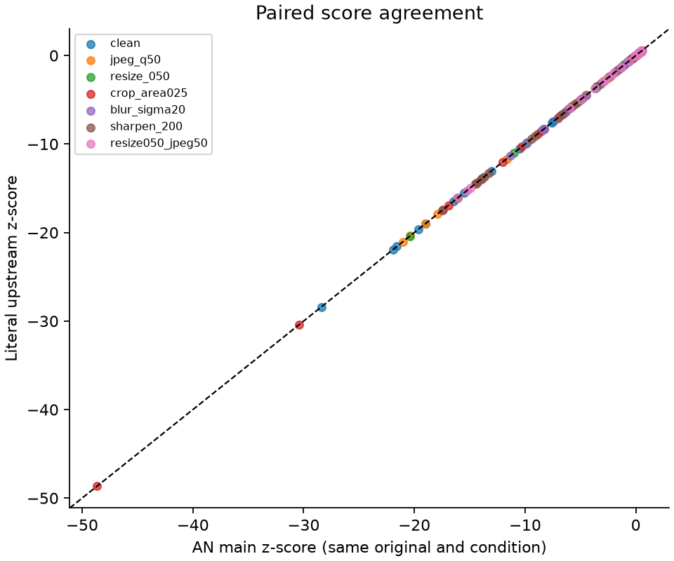
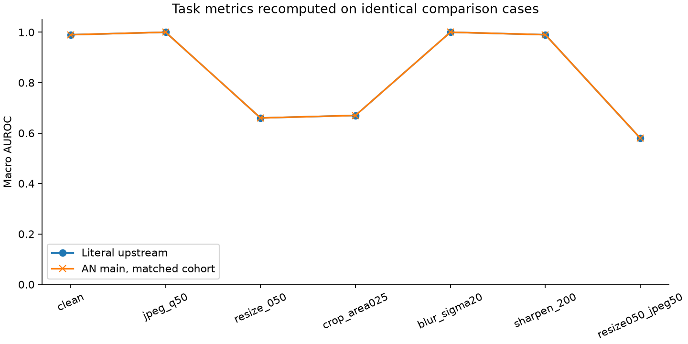
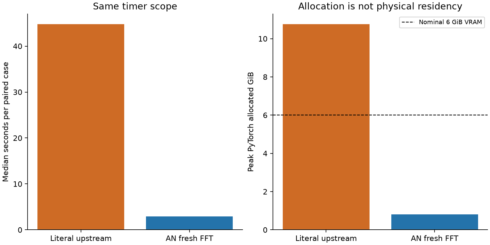

# Literal upstream versus AN FFT comparison

Status: **complete**; 175/175 paired cases completed.

The frozen cohort contains 25 test originals: 5 COCO photographs and 5 from each of DALL-E 3, Firefly, SDXL, and GLIDE. Both task-metric columns below are recomputed on exactly the same original-condition cases. They are not compared with the larger main-study headline result.

Released settings: `{'kernel_size': 11, 'num_scales': 3, 'max_size': 1024, 'resize_mode': 'resize_and_crop'}`. Float64 features are compared directly from caches.

| Condition | Literal upstream AUROC | AN main AUROC, same cases |
|---|---:|---:|
| clean | 0.990000 | 0.990000 |
| jpeg_q50 | 1.000000 | 1.000000 |
| resize_050 | 0.660000 | 0.660000 |
| crop_area025 | 0.670000 | 0.670000 |
| blur_sigma20 | 1.000000 | 1.000000 |
| sharpen_200 | 0.990000 | 0.990000 |
| resize050_jpeg50 | 0.580000 | 0.580000 |

| Condition | Released TPR, upstream / AN | Released FPR, upstream / AN | Mapped synthetic-source attribution accuracy (15 originals), upstream / AN |
|---|---:|---:|---:|
| clean | 0.950 / 0.950 | 0.000 / 0.000 | 0.400 / 0.400 |
| jpeg_q50 | 0.750 / 0.750 | 0.000 / 0.000 | 0.067 / 0.067 |
| resize_050 | 0.500 / 0.500 | 0.000 / 0.000 | 0.000 / 0.000 |
| crop_area025 | 0.500 / 0.500 | 0.000 / 0.000 | 0.000 / 0.000 |
| blur_sigma20 | 0.550 / 0.550 | 0.000 / 0.000 | 0.000 / 0.000 |
| sharpen_200 | 0.900 / 0.900 | 0.000 / 0.000 | 0.467 / 0.467 |
| resize050_jpeg50 | 0.450 / 0.450 | 0.200 / 0.200 | 0.000 / 0.000 |

AUROC is an equal-weight mean of the four real-versus-generator AUCs. [metrics.csv](metrics.csv) also reports each source, pooled AUC, TPR/FPR, and balanced accuracy. The attribution headline uses the 15 mapped synthetic originals from DALL-E 3, Firefly, and SDXL; COCO and unmapped GLIDE are excluded from that accuracy. [attribution_metrics.csv](attribution_metrics.csv) retains both the 15-synthetic and 20-mapped-source (including real) cohorts. The released classifier has no unknown rejection.

Largest upstream-versus-main absolute z difference: **3.54e-07**. Released decisions agree in **175/175** cases; attribution predictions agree in **175/175** cases. [comparison.csv](comparison.csv) includes raw/projected/attribution feature differences and fresh FFT rerun checks.

Fresh paired timing: literal-upstream median **44.765s**, AN FFT median **2.936s**; median per-case speed ratio **15.07×**. Saved main-study timings are not used in this speed comparison.

Timer scope: Synchronized FSD extraction + original detection/attribution components + additional14-source raw-likelihood diagnostic pass; CPU output copies included; image processing, feature disk writes, differences and public API checks excluded.

Diagnostic work: AN extraction includes its production residual/numerical diagnostics; upstream compute_fsd does not.

Order and allocator: Timed method order alternates by fixed planned case index: even upstream then AN; odd AN then upstream. The schedule is unchanged by resume. CUDA cache is retained normally, and reserved memory can include preceding method allocations. Allocated/reserved are logical PyTorch memory, not resident physical VRAM; WDDM/system-memory fallback can permit values above6GiB.

Memory values are PyTorch allocated/reserved peaks, not measurements of physical GPU residency. On Windows WDDM, allocations beyond the RTX 2060's 6 GiB can involve shared-memory paging; these measurements do not establish the same behavior on other GPU/OS configurations.

Processing is applied once to produce the shared upstream/fresh-FFT input. Its recorded pixel hash does not retroactively prove the earlier main input pixels: the main link is the frozen original, processing definition/code hashes, and numerical output comparison.

The purpose is implementation equivalence on this small, fixed cohort. It does not expand the main benchmark, establish population-level robustness, or remove possible checkpoint-training overlap. Repeated derivatives and semantically related Synthbuster prompts are not independent observations.

[Coverage](coverage.csv) · [Runtime and allocation](runtime.csv) · [Full audit JSON](comparison_summary.json)

Declared numerical limits are relative L2 ≤ 1e-04 for each raw/projected/attribution vector, absolute z difference ≤ 1e-03, and maximum source-probability difference ≤ 1e-04. Independent numeric verdicts: `{"upstream_vs_an_numeric_pass": true, "upstream_vs_main_numeric_pass": true, "an_vs_main_numeric_pass": true}`. These numeric tolerances are separate from discrete decision and source agreement. The frozen calibrated decisions agree in 175/175 upstream-versus-main cases.

The literal public `FSDDetector.score()` endpoint was checked in **2 cases** covering binary labels [0, 1]. Maximum raw-score difference was **0** and maximum z difference **0**; all released decisions agree: **True**. These extra endpoint checks are excluded from paired method timing. Their recorded differences and decisions are independently rechecked by this analyzer.

Within paired records, **5 literal `attribute()` probe matches** were also verified against their frozen probe files: maximum z difference **0**, maximum probability difference **0**, all sources/decisions match: **True/True**.

The separate literal public `FSDDetector.attribute()` probes provide an additional API check: **5 probes**, pass=True, maximum absolute z difference **9.46e-10**, and maximum source-probability difference **2.47e-09**. Their full evidence is recorded in `an/baseline_comparison/api_probe_audit.json`; these probes are separate from the paired timing table.

A recorded battery-power interruption affects timing interpretation. The conservative window is **2026-11-08T10:01:28.410029+00:00 to 2026-11-08T10:11:01.037496+00:00**; **5/175 cases** overlap it. The incident log reports a 10 W GPU cap and 300 MHz SM clock while on battery. No software or driver power settings were changed.

All cases remain in numerical comparisons, task metrics, and the overall timing results above. [runtime_power_strata.csv](runtime_power_strata.csv) supplements those results with whole-case overlapping/nonoverlapping timing groups. Boundary equality is conservatively flagged. An open window ends at the recorded analysis time; a closed window uses the recorded AC-restoration plus 60-second recovery boundary, without adding another recovery period.

| Timing stratum | Cases | Upstream median seconds | AN median seconds | Median paired speed ratio |
|---|---:|---:|---:|---:|
| all_cases | 175 | 44.765 | 2.936 | 15.070 |
| overlaps_incident_window | 5 | 46.186 | 2.982 | 15.479 |
| outside_incident_window | 170 | 44.743 | 2.932 | 15.053 |

Case-level overlap cannot identify which method's timed section was power-limited. Nonoverlap means outside the recorded window, not continuous proof of AC power. Strata are descriptive and not a randomized estimate of battery-power effects.

