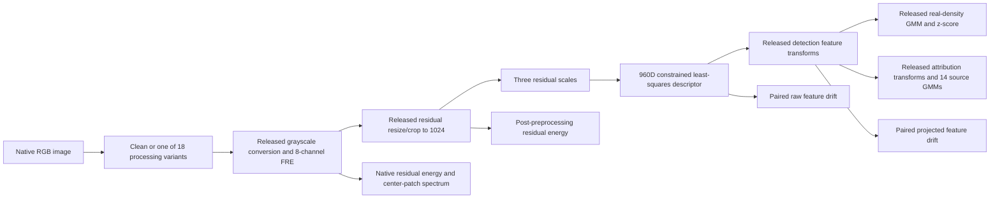

# Implementation and numerical fidelity

## Inference path

The image transformations are in `an/robustness/transforms.py`. Scoring imports
the repository's original FRE, transforms, and GMM code. New extraction code is
in `an/robustness/extractor.py`; nothing in the original `fsd/` tree was edited.

## Why extraction was optimized for memory

The release's `compute_fsd` reshapes every overlapping patch into a dense tensor
before chunking the normal-equation accumulation. At the official 1024 grid,
eight channels, 11×11 patches, three scales, and float64, those materialized
patches alone occupy about 9.93 GiB, exceeding the RTX 2060's 6 GiB physical
memory. This motivated avoiding those allocations. Reducing the resolution or
precision would change the model's input distribution or numerical calculation.

Subsequent literal upstream public-API probes at the default 1024 setting
**succeeded on this PC**. The first COCO probe took 93.3 seconds and reported
about 10.7 GiB of logical PyTorch CUDA allocation. Those observations are
consistent with Windows/NVIDIA shared-memory fallback or paging; no direct
memory-residency trace was collected. Oversized logical allocations therefore
do not establish that the original function is unable to run here. The AN
optimization avoids the oversized patch allocations and reduces runtime;
it was not strictly required for feasibility on this observed configuration.
The [direct upstream comparison](../baseline_comparison/RESULTS.md) reports
the completed probes and matched evaluation.

Two implementations accumulate the same equations:

- **Tiled reference:** form only a few rows of patches at a time and accumulate
  their Gram matrix and right-hand side in float64.
- **FFT method used for scoring:** construct circular-padding correlations by
  FFT, then subtract circular and add reflection-padding contributions for all
  patch centers affected by the image borders.

For residual channel `k`, neighborhood offset `u`, and pixel position `p`, the
design entry is `X[p,(k,u)] = R_k[p+u]`. The release's target is the sum of center
residuals across channels. With circular indexing, a Gram entry depends on the
offset difference `v-u`, so it can be obtained from a cross-correlation. Only
centers within five pixels of an edge differ from the release's reflection
padding. Direct correction at those centers restores the same observations.

The three scales, scale weighting by their actual number of pixels, ridge
`1e-5`, one sum-to-one constraint per channel, KKT solve, and official residual
preprocessing are unchanged. This is mathematical equivalence to the released
closed-form objective, not a claim of bit-for-bit equality or equivalence to the
paper's iterative optimizer. FFT and matrix accumulation have different
floating-point summation orders.

## Validation performed

- CPU regression tests compare explicit reflected patches, tiled extraction,
  FFT accumulation, and the original upstream function on tractable inputs.
- A trained-weight 1024-grid comparison checks both the descriptor and final
  detection score against the AN direct tiled calculation, not a literal call
  to the original full-patch extraction function.
- Ten full-resolution fixture cases cover flat/low-texture inputs and strong
  processing. These are numerical fixtures, not accuracy examples.
- Sixteen actual-data comparisons cover COCO, DALL-E 3, SDXL, and GLIDE under
  clean, blur sigma 2, resize 0.25, and JPEG Q50. They compare all 14 source GMMs
  as well as detection, using AN tiled extraction as the reference. All 16
  passed; the worst descriptor relative L2 error
  and absolute detection z-score difference were each about `1.78e-6`, on the
  smallest resized GLIDE input. All attribution top-1 predictions matched.
- That 16-case audit measured an average 1.24 seconds for the FFT path
  versus 19.64 seconds for the direct tiled path. Both timings include
  extraction diagnostics, detection, and all source-GMM scoring. Treat this as
  a validation microbenchmark, not a measurement of extraction alone or a
  guarantee of the same speedup for every input.

Machine-readable audit records are in `an/results/extractor_*audit.json` and
`an/results/extractor_validation_*.json`. The checks use predetermined numeric
tolerances and do not select evaluation images according to detector accuracy.

The direct upstream comparison then checked 25 originals under seven conditions
at the default 1024 setting. All 175 detection decisions and source predictions
matched. Maximum raw relative L2 difference was `3.40e-7` and maximum absolute
z-score difference was `3.54e-7`. The comparison uses explicit v1.2.0 weights
with official main commit `50f2eae06efdac2e5a33f407ca9a27a2295133ac`;
[source verification](../baseline_comparison/source_verification.md) distinguishes
that commit from the earlier v1.2.0 source tag. Historical audit snapshots remain
unchanged.

## Resource and reproducibility controls

All production extraction and scoring run in float64 on the RTX 2060. TF32 is
disabled. Inputs are processed one at a time, with no gradient tracking. Peak
GPU memory in per-image records is PyTorch's **allocated tensor memory**, not
total device memory; `gpu_telemetry.csv` separately records `nvidia-smi` memory,
utilization, temperature, and power.

The per-record `seconds` timer includes the image-domain transformation,
extraction and diagnostics, detection/attribution scoring, saving compressed
feature vectors, and feature-drift calculations. It stops before residual/image
preview saving, JSONL logging, and progress updates. Original-file decoding,
manifest verification, and model loading are outside this timer. The result
tensors and scores are copied to the CPU before the timer stops, so this is not
an unsynchronized CUDA-launch timing. `runtime.csv` summarizes these per-record
costs; phase `progress.json` supplies elapsed scoring-loop time including the
remaining loop overhead. Neither represents download/waiting time or the whole
command's setup time.

The allocated-memory peak is reset for each condition after its CPU image
transformation and includes resident model tensors. It excludes PyTorch's
unused reserved allocator blocks, CUDA context/library allocations, and other
processes. Consequently it is not an estimate of how much of the RTX 2060's
entire 6 GB was available, and it need not match `nvidia-smi`. Native FRE input
and residual allocations still depend on original image dimensions; only the
formerly enormous FSD patch materialization has been removed.

A read-only spot-check during the synthetic phase reported software thermal
slowdown active at 86.4 degrees C, an SM clock of 1080 MHz, and 36.81 W. Recorded
runtime therefore includes this machine's thermal state. The validation
microbenchmark and long-run throughput should not be generalized as fixed
hardware-independent costs or compared as a controlled thermal experiment.

Native input geometry is retained before the official FRE. Thus a fractional
resize starts from different dimensions in different datasets. The internal
residual normalization can upsample, and remains part of the measured system.
No claim is made that the results isolate only one resampling operation.

Each phase records weights, code hashes, environment, selected originals, and
expected conditions. The merge refuses incompatible protocols or overlapping
original hashes. Features, residual previews, and raw predictions are saved so
the analysis can be inspected or repeated without another GPU pass. A separate
verifier checks every output feature vector, coverage, normalization, artifact
hashes, plot files, and report links.

## Artifact validation

The verifier checks complete coverage, phase compatibility, input and artifact
hashes, finite features and scores, constraint residuals, and report links.
Constraint and KKT residuals supplement feature/score agreement; they alone do
not establish forward accuracy in an ill-conditioned system. The final reports
keep calibration originals outside test metrics and preserve the distinction
between ranking changes and threshold changes.

Residual galleries use actual scored originals, shared symmetric display scales,
and native patches of up to 128 × 128 pixels. Small processed inputs may supply
smaller patches. The geometric variants are illustrative, not aligned pixelwise
error maps. The completed checks are recorded in
[verification.json](../results/main/verification.json).

## Timing

On 8 November 2026, the real phase completed 2,000 cases in 2,751.391 seconds
and the synthetic phase completed 3,800 cases in 6,419.031 seconds, both with
zero errors. Their summed phase time is 9,170.422 seconds, or 2 hours 32 minutes
50 seconds. Scoring ran from approximately 13:42 to 16:15 Singapore time;
merge and analysis completed at 16:19. Environment-held download requests
extended total task wall time beyond the requested 6–7 hours. That waiting time
is excluded from compute measurements. Original timestamps remain in the run
metadata and progress snapshots.
