# AN robustness experiment

Analysis status: **complete_for_expected_conditions**.

This evaluates the released FSD checkpoint under deterministic image processing. It is not a reproduction of the complete CVPR 2025 benchmark, nor a measured social-media upload/download pipeline.

Scored clean test originals: **300**. Originals present in every requested/observed condition: **300**. Finite prediction records: **5800**.

Clean macro AUROC: **0.995** (95% interval 0.990–0.999); 100 real and 200 synthetic test images across 4 synthetic sources.

The lowest observed macro AUROC change is **resize_050**: -0.405 versus its matched clean cohort (95% paired interval -0.438–-0.377). The highest observed change is **blur_sigma05** (0.001). These are descriptive comparisons across this sweep; intervals are not corrected for multiple testing.

## Detection results

Macro values weight synthetic sources equally; real images are pooled in their observed proportions. Each condition uses only test originals with both clean and processed scores. The paired clean AUROC column exposes differences in cohort composition. Macro AP averages separate generator-versus-real comparisons; its class balance is the balance within each comparison, not the combined real/fake counts shown on the macro row. Pooled AP is reported separately in metrics.csv.

| Condition | Real | Fake | Macro AUROC | Matched clean | Change | Macro AP | Release FPR | Release TPR | Calibrated FPR | Calibrated TPR |
| --- | --- | --- | --- | --- | --- | --- | --- | --- | --- | --- |
| clean | 100 | 200 | 0.995 | 0.995 | 0.000 | 0.992 | 0.020 | 0.945 | 0.040 | 0.975 |
| jpeg_q95 | 100 | 200 | 0.995 | 0.995 | -0.000 | 0.991 | 0.020 | 0.950 | 0.030 | 0.970 |
| jpeg_q75 | 100 | 200 | 0.989 | 0.995 | -0.007 | 0.977 | 0.020 | 0.850 | 0.030 | 0.950 |
| jpeg_q50 | 100 | 200 | 0.967 | 0.995 | -0.028 | 0.927 | 0.030 | 0.730 | 0.080 | 0.865 |
| resize_075 | 100 | 200 | 0.782 | 0.995 | -0.214 | 0.671 | 0.030 | 0.220 | 0.070 | 0.435 |
| resize_050 | 100 | 200 | 0.590 | 0.995 | -0.405 | 0.593 | 0.020 | 0.465 | 0.050 | 0.485 |
| resize_025 | 100 | 200 | 0.848 | 0.995 | -0.148 | 0.723 | 0.000 | 0.280 | 0.010 | 0.310 |
| crop_area075 | 100 | 200 | 0.757 | 0.995 | -0.239 | 0.671 | 0.060 | 0.475 | 0.070 | 0.550 |
| crop_area050 | 100 | 200 | 0.620 | 0.995 | -0.376 | 0.520 | 0.040 | 0.140 | 0.120 | 0.310 |
| crop_area025 | 100 | 200 | 0.592 | 0.995 | -0.404 | 0.609 | 0.050 | 0.490 | 0.110 | 0.500 |
| blur_sigma05 | 100 | 200 | 0.997 | 0.995 | 0.001 | 0.993 | 0.010 | 0.920 | 0.020 | 0.960 |
| blur_sigma10 | 100 | 200 | 0.977 | 0.995 | -0.018 | 0.935 | 0.030 | 0.735 | 0.040 | 0.865 |
| blur_sigma20 | 100 | 200 | 0.992 | 0.995 | -0.004 | 0.969 | 0.010 | 0.665 | 0.020 | 0.780 |
| sharpen_050 | 100 | 200 | 0.995 | 0.995 | -0.000 | 0.992 | 0.020 | 0.935 | 0.020 | 0.980 |
| sharpen_100 | 100 | 200 | 0.995 | 0.995 | -0.000 | 0.991 | 0.020 | 0.945 | 0.020 | 0.975 |
| sharpen_200 | 100 | 200 | 0.995 | 0.995 | 0.000 | 0.992 | 0.020 | 0.945 | 0.020 | 0.975 |
| resize075_jpeg75 | 100 | 200 | 0.788 | 0.995 | -0.207 | 0.663 | 0.020 | 0.240 | 0.090 | 0.410 |
| resize050_jpeg75 | 100 | 200 | 0.618 | 0.995 | -0.378 | 0.619 | 0.020 | 0.490 | 0.080 | 0.535 |
| resize050_jpeg50 | 100 | 200 | 0.631 | 0.995 | -0.365 | 0.639 | 0.040 | 0.460 | 0.080 | 0.525 |

[All per-source and pooled metrics](metrics.csv) · [95% AUROC/delta intervals](auroc_intervals.csv) · [Common-cohort metrics](metrics_common_cohort.csv) · [Coverage](coverage.csv)

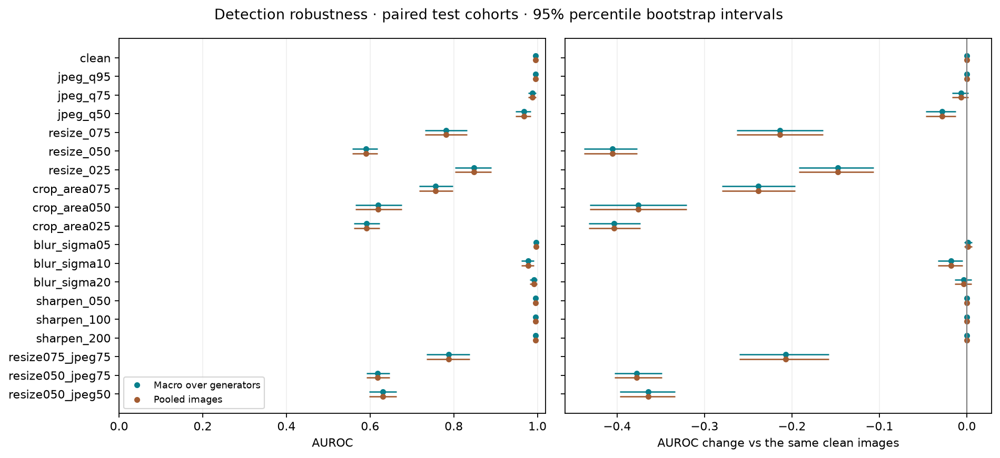

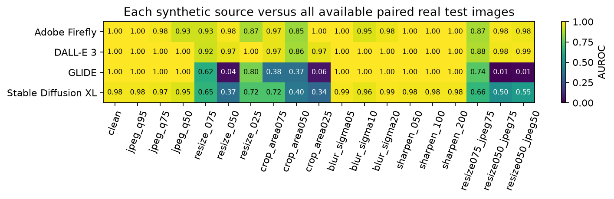

## Real-image domains and existing encoding

Each available real-image domain is analyzed separately. The table below records the domains actually evaluated; no result is claimed for an absent dataset. COCO images already carry JPEG history, so an additional JPEG save is recompression. Native encoding is read from file contents: a `.png` filename does not prove lossless encoding or an uncompressed history. Existing encoding, resolution, and camera populations can confound cross-source comparisons and remain relevant when interpreting processing sensitivity.

| Source | Fake label | Current encoding | Originals | Median width | Median height |
| --- | --- | --- | --- | --- | --- |
| Adobe Firefly | 1 | jpeg | 50 | 2304.000 | 1792.000 |
| COCO2017 | 0 | jpeg | 100 | 640.000 | 447.500 |
| DALL-E 3 | 1 | png | 50 | 1024.000 | 1024.000 |
| GLIDE | 1 | png | 50 | 256.000 | 256.000 |
| Stable Diffusion XL | 1 | png | 50 | 1088.000 | 928.000 |

[Every real domain versus every generator, with intervals and domain-specific FPR](real_domain_metrics.csv) · [Original domain/encoding summary](input_domain_summary.csv)

Each real-domain comparison retains the same frozen release and shared clean-calibrated thresholds; no domain-specific test threshold is fitted. Domain rows include per-generator, pooled-fake, and equally weighted generator-macro results.

| Clean real domain | Real | Fake | Macro AUROC | Release FPR | Calibrated FPR |
| --- | --- | --- | --- | --- | --- |
| COCO2017 | 100 | 200 | 0.995 | 0.020 | 0.040 |

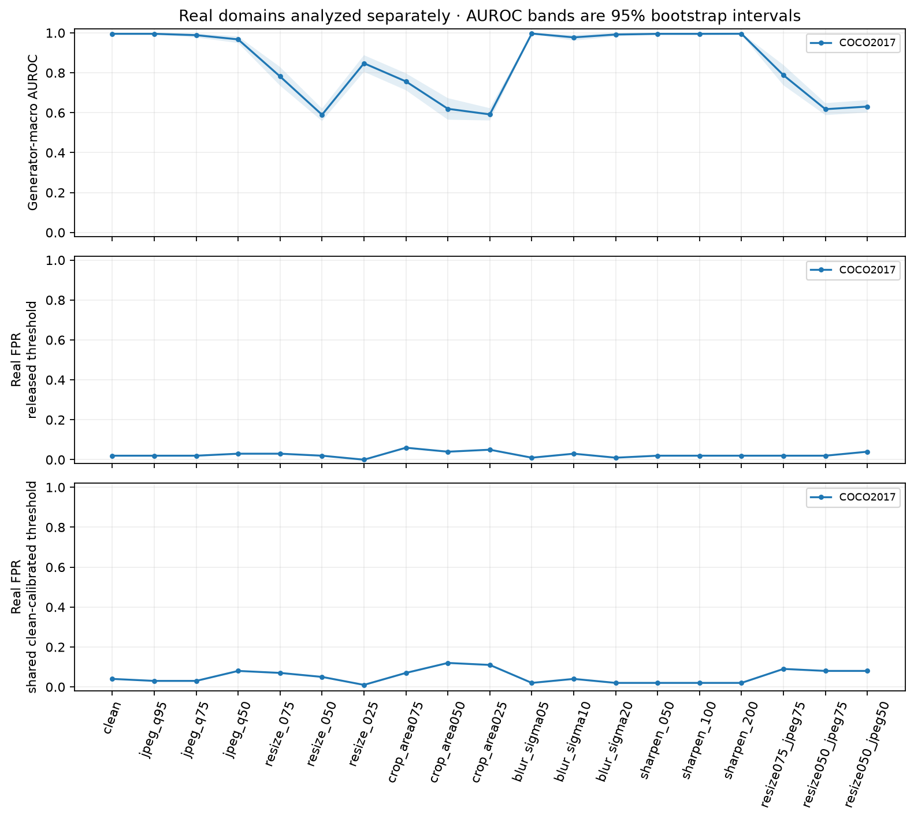

## Thresholds and uncertainty

The release comparison uses z < −2 (equivalently anomaly > 2). The second threshold is frozen using only the 95th percentile of clean real calibration anomaly scores, with NumPy's `higher` quantile and a strict `>` decision. No transformed test images select a threshold.

Calibration images: **100**; anomaly cutoff: **0.994**; empirical calibration FPR: **0.040**. A target 5% calibration FPR does not guarantee 5% FPR on another domain or on processed images.

Calibration domain counts: COCO2017=100.

Intervals use **1000** percentile bootstrap draws, seed **20261108**, resampling original image IDs separately within each label/source stratum. Each draw reuses identical multiplicities for clean and processed scores. Macro intervals are computed from jointly resampled source AUROCs. They describe sampling uncertainty conditional on these selected sources and the fixed threshold; they do not cover checkpoint training uncertainty or unseen-source variation.

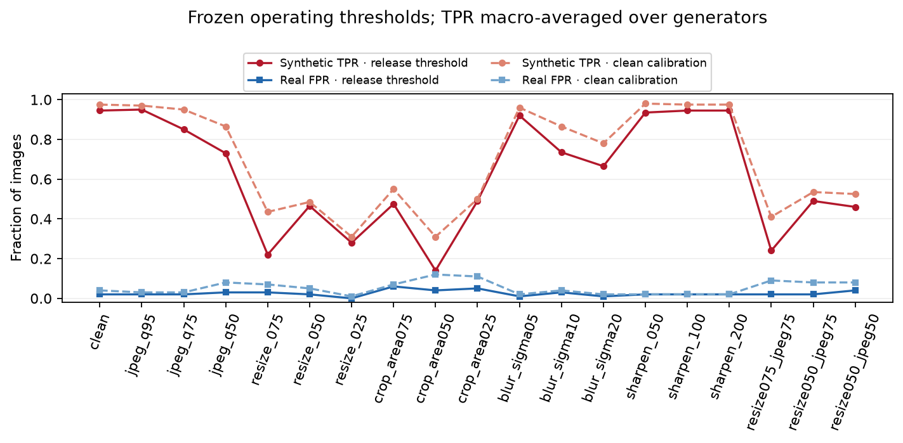

## Residuals and 960D descriptors

Raw descriptor drift is separate from the learned projected-feature drift. Ratios are relative to the same original image; residual RMS summarizes amplitude and does not require pixelwise alignment of different-size images. Associations between drift and performance are descriptive, not proof of a causal mechanism.

[Per-source feature/residual summaries](feature_drift.csv)

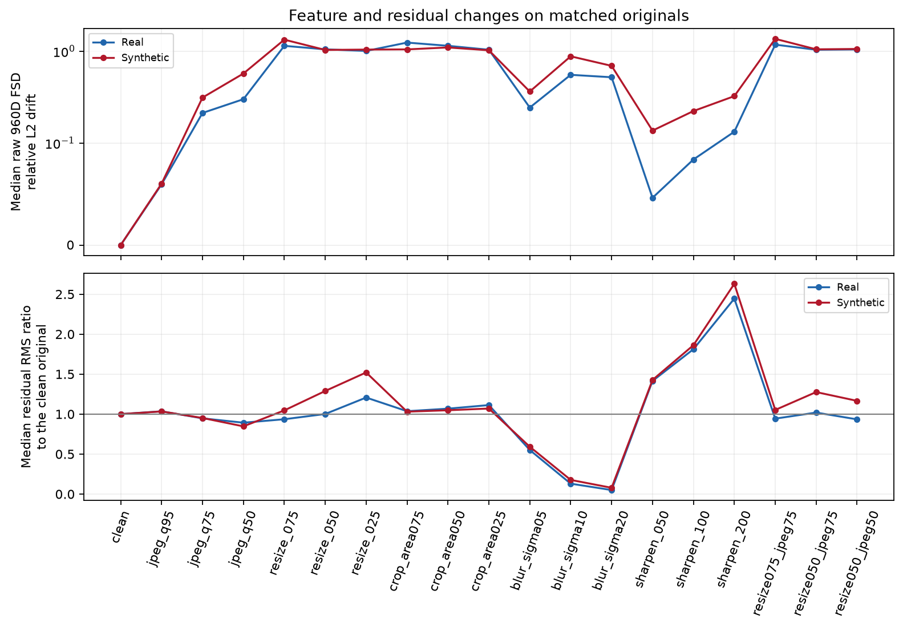

Native residual RMS and high-frequency energy are measured before internal model resizing. The spectrum statistic uses a demeaned, Hann-windowed native center patch of up to 128×128 pixels and a cutoff of 0.25 cycles/pixel. Smaller processed images use smaller patches, so frequency resolution differs; actual patch shapes are recorded per image. Changes in crop/resize conditions are not aligned pixelwise residual differences.

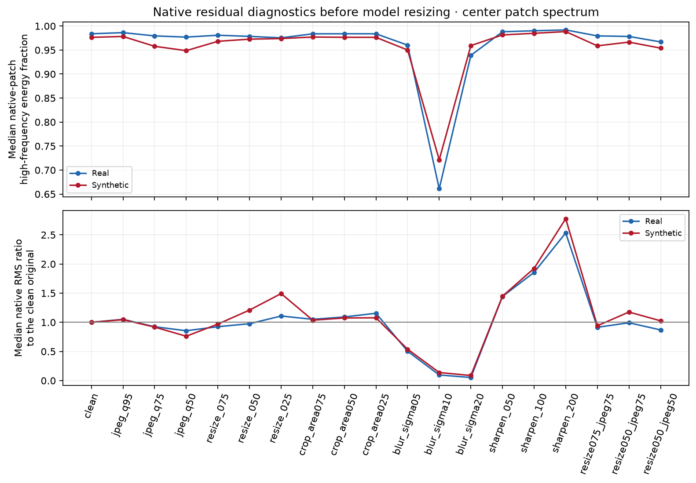

The following examples were selected in record order among originals with saved previews, rather than selected by correctness. Within each original, residual and coefficient panels share display limits across conditions; the color ranges are clipped at the 99th absolute percentile for visibility. These examples illustrate the aggregate measurements and do not establish typical performance on their own.

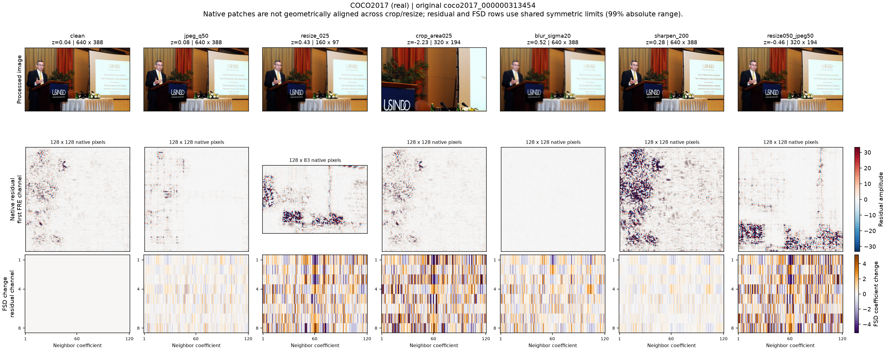

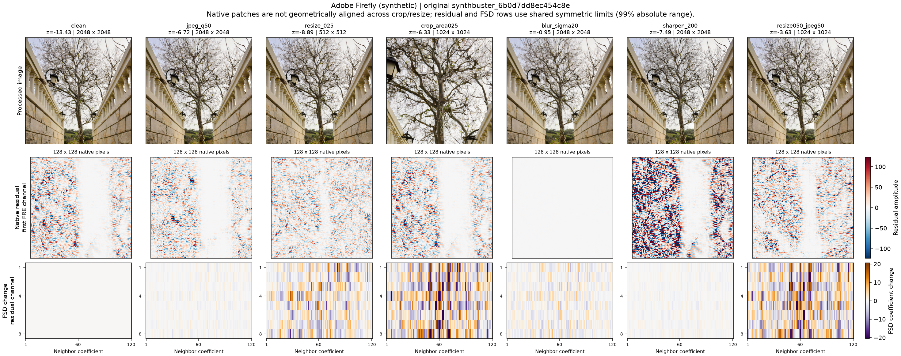

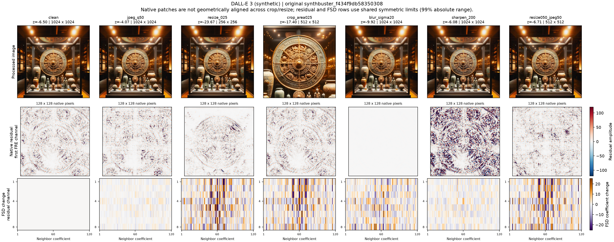

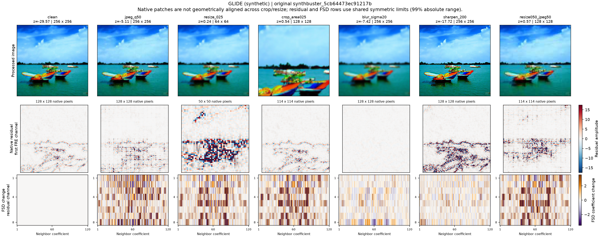

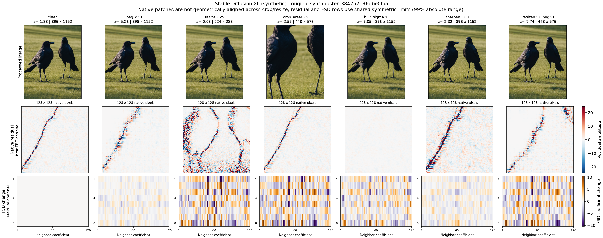

## Source attribution

Accuracy is restricted to test sources with explicit checkpoint-label mappings. Predictions still range over the full released classifier's source set. These are closed-set top-1 measurements on supported sources; there is no unknown rejection or open-set performance claim. The confidence output is not a validated probability of correctness.

| Condition | Known fake images | Macro accuracy | Matched clean | Change | Prediction flips |
| --- | --- | --- | --- | --- | --- |
| clean | 150 | 0.393 | 0.393 | 0.000 | 0.000 |
| jpeg_q95 | 150 | 0.387 | 0.393 | -0.007 | 0.113 |
| jpeg_q75 | 150 | 0.193 | 0.393 | -0.200 | 0.487 |
| jpeg_q50 | 150 | 0.040 | 0.393 | -0.353 | 0.747 |
| resize_075 | 150 | 0.000 | 0.393 | -0.393 | 0.853 |
| resize_050 | 150 | 0.000 | 0.393 | -0.393 | 0.867 |
| resize_025 | 150 | 0.000 | 0.393 | -0.393 | 0.867 |
| crop_area075 | 150 | 0.227 | 0.393 | -0.167 | 0.600 |
| crop_area050 | 150 | 0.000 | 0.393 | -0.393 | 0.867 |
| crop_area025 | 150 | 0.000 | 0.393 | -0.393 | 0.867 |
| blur_sigma05 | 150 | 0.333 | 0.393 | -0.060 | 0.367 |
| blur_sigma10 | 150 | 0.007 | 0.393 | -0.387 | 0.860 |
| blur_sigma20 | 150 | 0.027 | 0.393 | -0.367 | 0.760 |
| sharpen_050 | 150 | 0.393 | 0.393 | 0.000 | 0.140 |
| sharpen_100 | 150 | 0.400 | 0.393 | 0.007 | 0.207 |
| sharpen_200 | 150 | 0.427 | 0.393 | 0.033 | 0.307 |
| resize075_jpeg75 | 150 | 0.000 | 0.393 | -0.393 | 0.853 |
| resize050_jpeg75 | 150 | 0.000 | 0.393 | -0.393 | 0.867 |
| resize050_jpeg50 | 150 | 0.000 | 0.393 | -0.393 | 0.873 |

[Attribution metrics](attribution_metrics.csv) · [Predictions for mapped and unmapped sources](attribution_predictions.csv)

## Measured implications and next experiments

Prioritize **resize_050** for a larger held-out replication: it has the largest measured macro ranking loss in this run. Inspect source-level outcomes before treating the aggregate as a property of every generator.
The highest processed real-image FPR at the frozen clean-calibrated threshold is **crop_area050** (12.0%). A separate follow-up can calibrate on processed real development images, then evaluate untouched test images; do not retroactively optimize this run's test threshold.
Within this sample, the lower 95% delta bound is above −0.02 for: jpeg_q95, jpeg_q75, blur_sigma05, blur_sigma20, sharpen_050, sharpen_100, sharpen_200. This supports only a sample-conditional small-loss statement, not universal robustness.
Use additional real-camera domains, unseen generators, more independent originals, and held-out processing severities for confirmation. Native-resolution crop aggregation or a real-only density model covering processing conditions are candidates for a separately trained and independently tested mitigation study.

## Runtime and reproducibility

[Test runtime summary](runtime.csv) · [Separate calibration timing](runtime_calibration.csv) · [Machine-readable analysis configuration](analysis_summary.json) · [Raw per-image predictions](records.jsonl)

The runtime table and plot use the same condition-specific clean-paired test originals. Calibration records are excluded and summarized separately. Counts can differ across conditions when paired test records are missing.

Per-condition image processing, feature extraction, scoring, compressed feature-cache writing, and drift calculation; excludes initial image decoding and later preview/record writing.

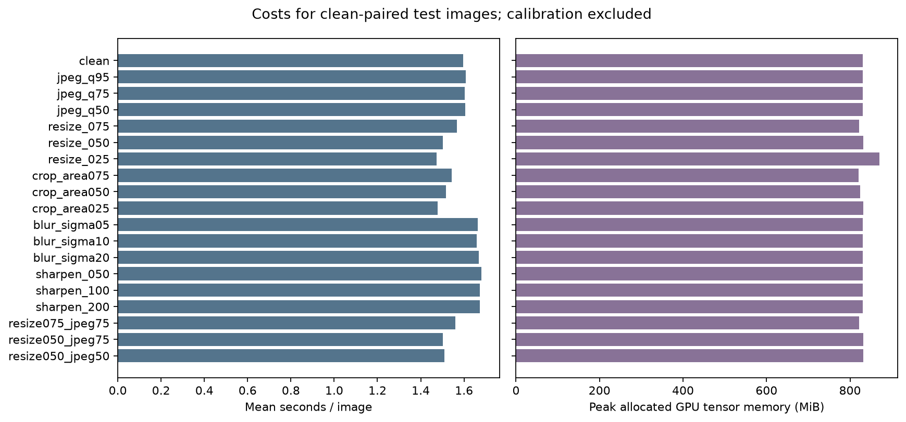

All derivative conditions share their original image identity. Checkpoint training overlap with public evaluation images cannot be ruled out without the checkpoint authors' image-level training manifest. A local calibration/test split establishes only separation within this experiment.

## Coverage and limitations

| Condition | Scored test | Paired | Expected test | Missing expected | Missing vs clean | No clean match |
| --- | --- | --- | --- | --- | --- | --- |
| clean | 300 | 300 | 300 | 0 | 0 | 0 |
| jpeg_q95 | 300 | 300 | 300 | 0 | 0 | 0 |
| jpeg_q75 | 300 | 300 | 300 | 0 | 0 | 0 |
| jpeg_q50 | 300 | 300 | 300 | 0 | 0 | 0 |
| resize_075 | 300 | 300 | 300 | 0 | 0 | 0 |
| resize_050 | 300 | 300 | 300 | 0 | 0 | 0 |
| resize_025 | 300 | 300 | 300 | 0 | 0 | 0 |
| crop_area075 | 300 | 300 | 300 | 0 | 0 | 0 |
| crop_area050 | 300 | 300 | 300 | 0 | 0 | 0 |
| crop_area025 | 300 | 300 | 300 | 0 | 0 | 0 |
| blur_sigma05 | 300 | 300 | 300 | 0 | 0 | 0 |
| blur_sigma10 | 300 | 300 | 300 | 0 | 0 | 0 |
| blur_sigma20 | 300 | 300 | 300 | 0 | 0 | 0 |
| sharpen_050 | 300 | 300 | 300 | 0 | 0 | 0 |
| sharpen_100 | 300 | 300 | 300 | 0 | 0 | 0 |
| sharpen_200 | 300 | 300 | 300 | 0 | 0 | 0 |
| resize075_jpeg75 | 300 | 300 | 300 | 0 | 0 | 0 |
| resize050_jpeg75 | 300 | 300 | 300 | 0 | 0 | 0 |
| resize050_jpeg50 | 300 | 300 | 300 | 0 | 0 | 0 |

This report is an analysis snapshot. If the experiment resumes, rerun `an/analyze_results.py` to refresh it. Absent or failed records are not counted as correct predictions.

Research context and primary-source links: [research notes](../../docs/research.md).

## Supplementary dependence check

The 200 synthetic test originals have 181 distinct archive-stem proxy groups; 18 stems repeat across generators. These are unconfirmed reference-content proxies. A separate sensitivity analysis resamples shared stems together while retaining the primary point estimates and the original image/source-stratified intervals.

[Proxy-cluster sensitivity and interpretation](content_sensitivity.md) · [Supplementary interval table](content_sensitivity_metrics.csv).
